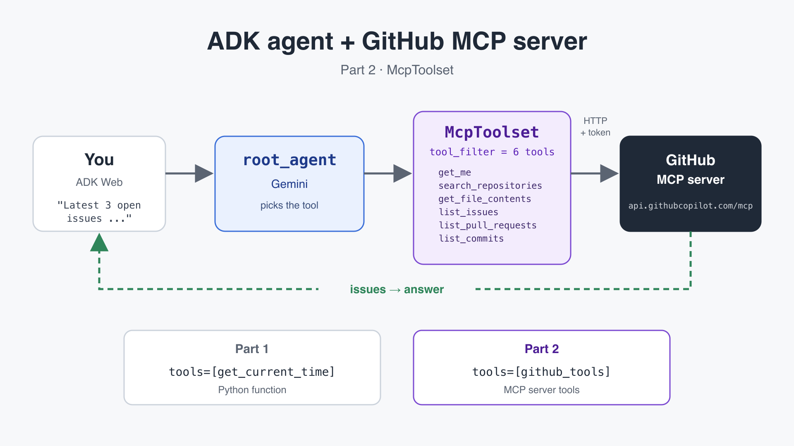

# ADK Tutorial

Code for the Google ADK (Agent Development Kit) video tutorial series. Each folder is a standalone agent you can run with `adk web`.

| Folder | Part | What you learn |
|---|---|---|
| [`my_agent/`](my_agent/) | Part 1 | Your first agent with a Python function as a tool |
| [`mcp_agent/`](mcp_agent/) | Part 2 | Connect an agent to the GitHub MCP server with `McpToolset` |
| [`adk-memory/`](adk-memory/) | Part 3 | Memory that survives restarts: session state with `user:`, `DatabaseSessionService` and `MemoryService` |

## Requirements

- Python 3.10 or later
- A Gemini API key from [Google AI Studio](https://aistudio.google.com/apikey)
- For Part 2: a [GitHub personal access token](https://github.com/settings/personal-access-tokens)

## Setup

```bash
git clone https://github.com/dyronrh/adk-tutorial.git
cd adk-tutorial
python3 -m venv .venv
source .venv/bin/activate
pip install -r requirements.txt
```

## Part 1: your first agent

A minimal agent with one tool, `get_current_time`, written as a plain Python function.

1. Create the `.env` file and add your Gemini API key:

   ```bash
   cp my_agent/.env.example my_agent/.env
   ```

2. Start the web UI from the repo root:

   ```bash
   adk web --port 8000
   ```

3. Open http://127.0.0.1:8000, pick `my_agent` and ask:

   ```
   What time is it in Tokyo?
   ```

## Part 2: GitHub MCP server



Instead of writing each tool yourself, the agent uses tools from GitHub's official MCP server. The only change from Part 1 is the `tools` line:

```python
tools=[get_current_time]   # Part 1: a Python function
tools=[github_tools]       # Part 2: an McpToolset
```

Key points in [`mcp_agent/agent.py`](mcp_agent/agent.py):

- `StreamableHTTPConnectionParams` connects over HTTP to `https://api.githubcopilot.com/mcp/`. Nothing to install locally.
- The GitHub token is sent in the `Authorization` header.
- `timeout=30` gives the first connection enough time (the default is 5 seconds).
- `tool_filter` keeps only six read-only tools out of 40+: `get_me`, `search_repositories`, `get_file_contents`, `list_issues`, `list_pull_requests`, `list_commits`.

1. Create the `.env` file and add your Gemini API key and GitHub token:

   ```bash
   cp mcp_agent/.env.example mcp_agent/.env
   ```

   A fine-grained token with read-only access is enough. Never commit your `.env` file.

2. Start the web UI from the repo root:

   ```bash
   adk web --port 8000
   ```

3. Open http://127.0.0.1:8000, pick `mcp_agent` and try:

   ```
   Latest 3 open issues in google/adk-python
   Show the README of google/adk-python
   Who am I on GitHub?
   ```

4. Click a tool event in the UI to see the `FUNCTION CALL` the agent sent and the `FUNCTION RESPONSE` GitHub returned.

## Practice ideas

- Add `search_code` or `list_branches` to `tool_filter` and ask questions that need them.
- Change the `instruction` so the agent always answers with a table.
- Connect a different MCP server with another `McpToolset`.

## Troubleshooting

| Error | Fix |
|---|---|
| `ImportError` for `McpToolset` | Install the MCP extra: `pip install "google-adk[mcp]"` |
| `401 API key not valid` | Check `GOOGLE_API_KEY` in the agent's `.env`. Each variable must be on its own line. |
| `Failed to create MCP session: timed out` | Keep `timeout=30` in `StreamableHTTPConnectionParams`. |
| The agent answers without using tools | Check `GITHUB_PERSONAL_ACCESS_TOKEN` in `mcp_agent/.env`. |
| Port 8000 already in use | `lsof -ti :8000 \| xargs kill`, or use `adk web --port 8001`. |

## Part 3: memory (sessions, state and MemoryService)

Why your agent remembers everything on your laptop but forgets on Cloud Run, and how to fix it. Everything is in [`adk-memory/`](adk-memory/) (the folder README is in Spanish, like the video).

```bash
cd adk-memory
pip install -r requirements.txt
python test_persistencia.py          # no API key needed
python memoria_largo_plazo.py        # no API key needed
python main.py "Hola, me llamo Dayron y programo en Go"
python main.py "¿En qué lenguaje programo?"   # new conversation → "Go"
```

The trap from the video: `sqlite://memoria.db` (two slashes) is not a path; with `adk web` or `--session_service_uri` ADK silently falls back to in-memory storage. Use three slashes: `sqlite:///memoria.db`.

