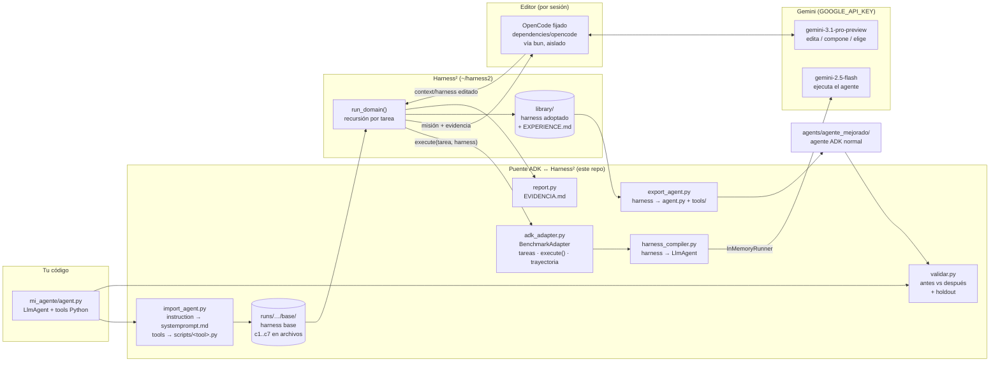
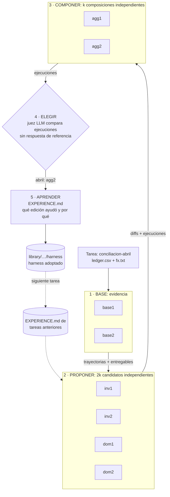
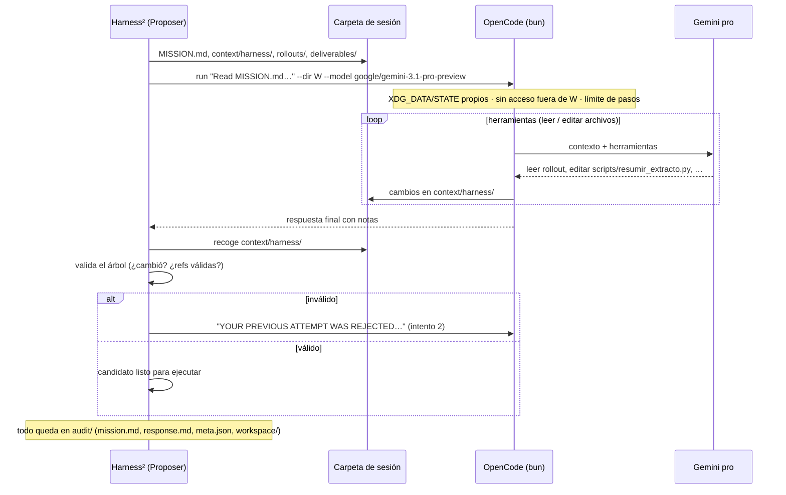
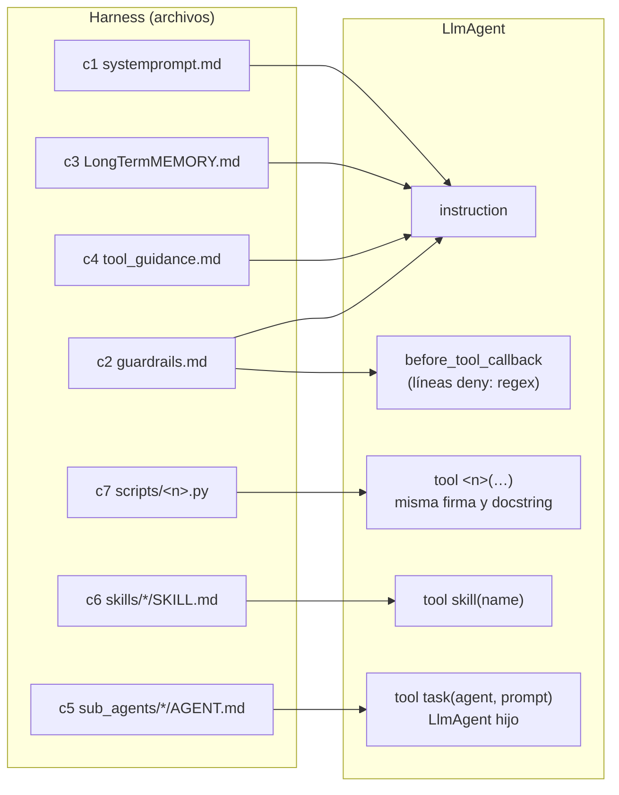

# Arquitectura: Harness² mejorando un agente de Google ADK

Versión Excalidraw (editable) en [diagramas/](diagramas/): ábrelos en https://excalidraw.com
(menú → Open) o con la extensión "Excalidraw" de VS Code. Se regeneran con
`python diagramas/generar.py`.

| Archivo | Contenido |
|---|---|
| `diagramas/1-arquitectura-general.excalidraw` | componentes y flujo de punta a punta |
| `diagramas/2-ciclo-por-tarea.excalidraw` | las 5 etapas por tarea, con los resultados reales de abril |
| `diagramas/3-sesion-del-editor.excalidraw` | qué hace una sesión de OpenCode |
| `diagramas/4-harness-a-adk.excalidraw` | cómo c1..c7 se convierten en un `LlmAgent` |

## 1. Vista general

## 2. Qué pasa en cada tarea (`--k 2 --mode parallel`)

Cada nodo de las etapas 2 a 5 es **una sesión de OpenCode** (Gemini editando archivos), y cada
candidato de las etapas 1 a 3 se **ejecuta** como agente ADK en la misma tarea.

- **inv** (investigar): busca en las trayectorias de base el momento en que falla y corrige ese componente.
- **dom** (dominio): propone cambios desde el conocimiento del dominio.
- **agg** (agregar): ve todos los candidatos con sus diffs y resultados; conserva lo que funcionó.

## 3. Una sesión del editor

## 4. Cómo un harness se vuelve un agente ADK (`harness_compiler.py`)

c8 (plugins) no está mapeado. Las tools importadas desde `mi_agente` se ejecutan como
subproceso (`python3 scripts/<n>.py '{json}'`) dentro del workspace de la tarea.

## 5. Dónde queda cada cosa

| Artefacto | Ruta |
|---|---|
| Agente de partida | `mi_agente/agent.py` |
| Harness base | `runs/adk_real_k2/base/` |
| Árbol de cada candidato | `runs/adk_real_k2/runs/<corrida>/<tarea>/harnesses/<candidato>/` |
| Ejecución de cada candidato | `runs/adk_real_k2/executions/<corrida>/<tarea>/<candidato>/trajectory.md` |
| Sesiones del editor | `runs/adk_real_k2/audit/` |
| Selección | `runs/adk_real_k2/runs/<corrida>/<tarea>/selection/*/selection.json` |
| Harness adoptado + lección | `runs/adk_real_k2/library/k2/agg/contabilidad/harnesses/<tarea>/` |
| Agente mejorado | `agents/agente_mejorado/` |
| Reporte por candidato | `runs/adk_real_k2/EVIDENCIA.md` |
| Validación antes/después | `runs/validacion.md` |
